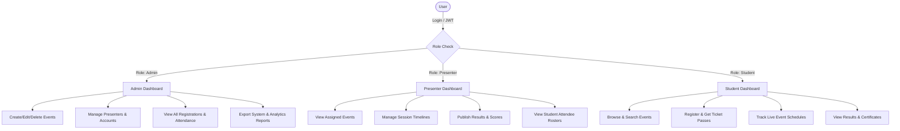

# 🏛️ College Event Presenter Management System

> A modern, full-stack college event management web application engineered to automate event creation, presenter & keynote coordination, student registrations, multi-session schedules, competitive leaderboards, and verified certifications.

---

## 📌 1. Problem Statement
Traditional university event management often suffers from disconnected paperwork, manual attendance tracking, lack of real-time seat availability, duplicate registrations, and uncoordinated communication between faculty leads, guest presenters, and student attendees. 

This **College Event Presenter Management System** addresses these issues by delivering a centralized, role-based platform that coordinates event scheduling, enforces capacity constraints, prevents duplicate registrations, publishes verifiable results, and generates actionable analytics.

---

## 🎯 2. Project Objectives
1. **Automated Event Lifecycle**: Streamline event creation, categorized filtering, and capacity management.
2. **Presenter & Coordinator Management**: Assign designated faculty/speakers to sessions, allowing them to manage schedules, view attendee rosters, and evaluate winners.
3. **Frictionless Student Experience**: Enable 1-click registration, instant digital ticket passes (with unique QR token IDs), schedule tracking, and personal award certificates.
4. **Data Integrity & Security**: Use MongoDB unique compound indexes to prevent duplicate event registrations, enforce JWT authentication, and provide role-based access control (RBAC).
5. **Auditing & Reporting**: Real-time capacity utilization analytics, department-wise breakdowns, printable formats, and CSV data export.

---

## 🛠️ 3. Technology Stack

### Frontend
- **HTML5 & CSS3**: Modern glassmorphic university design, CSS variables, CSS grid/flexbox, custom `@media print` stylesheets.
- **JavaScript (ES6+)**: Single-Page Application (SPA) architecture with client-side hash router, Fetch API client with JWT interceptor, toast notification engine, and modal manager.

### Backend
- **Node.js & Express.js**: RESTful API architecture, modular MVC pattern, error handling middleware, request validation.
- **Authentication & Security**: JSON Web Tokens (`jsonwebtoken`), password hashing (`bcryptjs`), Role-Based Access Control (`authorize('admin', 'presenter')`).

### Database
- **MongoDB**: NoSQL database (`college_event_db`).
- **Mongoose ODM**: Strongly-typed schemas, virtuals, timestamps, population references, and compound indexes (`{ event: 1, student: 1 }`).
- **Built-in Fallback**: Automatic support for local MongoDB, MongoDB Atlas, and embedded in-memory MongoDB engine (`mongodb-memory-server`) for zero-setup execution.

---

## 👥 4. User Roles & Capabilities



### 1. 🛡️ Administrator (`admin`)
- Full CRUD operations on events, presenters, and user accounts.
- Monitor total capacity, active registrations, and attendance conversion rates.
- Manage event schedules, assign presenters, and publish competitive results.
- Generate and download CSV audit reports.

### 2. 🎙️ Event Coordinator / Presenter (`presenter`)
- Access a specialized presenter portal with assigned events.
- Manage multi-session schedules and timelines for assigned events.
- View registered student rosters with contact details.
- Score students and publish official rankings (1st, 2nd, 3rd, awards, certificates).

### 3. 🎓 Student Participant (`student`)
- Browse events by category, status, date, or keyword search.
- 1-Click event registration with instant ticket code generation.
- Real-time seat availability indicators and automated duplicate registration prevention.
- View digital passes and cancel registrations when needed.
- View personalized achievements and verified award certificates.

---

## 🗄️ 5. MongoDB Database Collections

| Collection | Description | Key Fields |
|---|---|---|
| `users` | User credentials & role | `name`, `email` (unique), `password` (hashed), `role` (`admin`\|`presenter`\|`student`), `avatar` |
| `students` | Student academic profile | `user` (ref), `studentId` (unique), `department`, `year`, `phone` |
| `presenters` | Presenter professional bio | `user` (ref), `designation`, `department`, `contact`, `bio`, `specialization` |
| `events` | College events directory | `title`, `description`, `category`, `venue`, `eventDate`, `startTime`, `endTime`, `capacity`, `presenter` (ref), `status` |
| `registrations` | Event ticket bookings | `event` (ref), `student` (ref), `registrationDate`, `registrationStatus`, `attended`, `qrCodeToken` **[Unique index on `(event, student)`]** |
| `schedules` | Event session timeline | `event` (ref), `activityName`, `scheduleDate`, `startTime`, `endTime`, `venue`, `speakerOrLead` |
| `results` | Rankings and scores | `event` (ref), `student` (ref), `position`, `score`, `remarks`, `certificateIssued` **[Unique index on `(event, student)`]** |
| `notifications` | User alerts & updates | `user` (ref), `message`, `type`, `link`, `isRead`, `createdAt` |

---

## 🚀 6. Installation & Quick Setup

### Prerequisites
- [Node.js](https://nodejs.org/) (v16.x or higher)
- [MongoDB](https://www.mongodb.com/) (Optional: works with local MongoDB, MongoDB Atlas URI, or the embedded fallback engine!)

### Step-by-Step Instructions

1. **Clone or Navigate to the Project Directory**:
   ```bash
   cd college-event-presenter
   ```

2. **Install Dependencies**:
   ```bash
   npm install
   ```

3. **Configure Environment Variables**:
   Copy `.env.example` to `.env` (already configured with sensible defaults):
   ```ini
   PORT=5000
   MONGODB_URI=mongodb://127.0.0.1:27017/college_event_db
   JWT_SECRET=super_secret_college_event_jwt_key_2026_jwt_token
   JWT_EXPIRE=7d
   NODE_ENV=development
   USE_MEMORY_DB_FALLBACK=true
   ```

4. **Seed Sample Data (Optional / Automatic)**:
   The application **automatically seeds rich demo data** on first run if the database is empty. You can also manually reseed anytime:
   ```bash
   npm run seed
   ```

5. **Start the Application**:
   ```bash
   npm start
   ```

6. **Open in Browser**:
   Open [http://localhost:5000](http://localhost:5000) in any modern web browser.

---

## 🔑 7. Demo Evaluation Accounts

On the **Login Page**, click any of the **1-Click Demo Buttons** to autofill credentials:

| Role | Email | Password | Description |
|---|---|---|---|
| **🛡️ Admin** | `admin@college.edu` | `adminpassword123` | Full administrative control & analytics |
| **🎙️ Presenter** | `dr.sarah@college.edu` | `presenter123` | Coordinator: Dr. Sarah Jenkins (Head of AI) |
| **🎓 Student** | `alex.morgan@college.edu` | `student123` | Student: Alex Morgan (CS 3rd Year) |

---

## 📡 8. REST API Specification

### Authentication (`/api/auth`)
- `POST /api/auth/register` — Register new user (Student / Presenter)
- `POST /api/auth/login` — Authenticate and receive JWT token
- `GET /api/auth/profile` — Get authenticated user details *(Protected)*
- `PUT /api/auth/profile` — Update user profile & credentials *(Protected)*
- `GET /api/auth/users` — Get all users list *(Admin)*

### Events (`/api/events`)
- `GET /api/events` — Get all events with category, status, and keyword filters
- `GET /api/events/:id` — Get single event with schedules, presenter, and results
- `POST /api/events` — Create new event *(Admin / Presenter)*
- `PUT /api/events/:id` — Update event details *(Admin / Assigned Presenter)*
- `DELETE /api/events/:id` — Delete event and cascade remove registrations *(Admin)*
- `GET /api/events/stats/overview` — Get metric counts for dashboard *(Protected)*

### Presenters (`/api/presenters`)
- `GET /api/presenters` — List all presenters with assigned event counts
- `GET /api/presenters/:id` — Get presenter profile and assigned events
- `POST /api/presenters` — Create new presenter profile *(Admin)*
- `PUT /api/presenters/:id` — Update presenter bio & designation *(Admin / Presenter)*
- `DELETE /api/presenters/:id` — Remove presenter *(Admin)*
- `GET /api/presenters/my/assigned-events` — Get events assigned to logged-in presenter *(Presenter)*

### Registrations (`/api/registrations`)
- `POST /api/registrations` — Register student for an event (enforces capacity & duplicate check) *(Student)*
- `GET /api/registrations/my` — Get logged-in student's registrations & passes *(Student)*
- `GET /api/registrations/event/:eventId` — Get all attendees for a specific event *(Admin / Presenter)*
- `GET /api/registrations` — Master registration list with search & filters *(Admin / Presenter)*
- `DELETE /api/registrations/:id` — Cancel registration *(Student owner / Admin)*
- `PUT /api/registrations/:id/status` — Mark attendance status *(Admin / Presenter)*

### Schedules (`/api/schedules`)
- `GET /api/schedules/:eventId` — Get schedule timeline for an event
- `POST /api/schedules` — Add session to event timeline *(Admin / Presenter)*
- `PUT /api/schedules/:id` — Update session details *(Admin / Presenter)*
- `DELETE /api/schedules/:id` — Remove session from schedule *(Admin / Presenter)*

### Results & Leaderboard (`/api/results`)
- `GET /api/results/:eventId` — Get published leaderboard for an event
- `GET /api/results/my` — Get student's achievements and certificates *(Student)*
- `POST /api/results` — Publish ranking, score, and certificate *(Admin / Presenter)*
- `PUT /api/results/:id` — Update result entry *(Admin / Presenter)*
- `DELETE /api/results/:id` — Remove result entry *(Admin / Presenter)*

### Reports & Analytics (`/api/reports`)
- `GET /api/reports/events` — Events capacity utilization summary *(Admin / Presenter)*
- `GET /api/reports/registrations` — Department & status audit breakdown *(Admin / Presenter)*
- `GET /api/reports/presenters` — Presenter engagement metrics *(Admin)*
- `GET /api/reports/results` — Awards and competition results summary *(Admin / Presenter)*
- `GET /api/reports/export/csv?type=events|registrations|results` — Export dynamic `.csv` spreadsheet file *(Admin / Presenter)*

### Notifications (`/api/notifications`)
- `GET /api/notifications` — Get user notifications with unread count *(Protected)*
- `PUT /api/notifications/read-all` — Mark all notifications as read *(Protected)*
- `PUT /api/notifications/:id/read` — Mark single notification as read *(Protected)*
- `DELETE /api/notifications/:id` — Delete notification *(Protected)*

---

## 🧪 9. Automated Testing

The project includes an end-to-end automated test suite verifying all 28 API workflows, duplicate prevention, capacity limits, and RBAC permissions.

To run the automated tests:
```bash
npm test
```

### Test Results Summary
```
===========================================================
 TEST RUN COMPLETED! Passed: 28, Failed: 0
===========================================================
  ✓ PASS: API Health Check returns 200 online
  ✓ PASS: Admin Login successful with JWT token
  ✓ PASS: Presenter Login successful with JWT token
  ✓ PASS: New Student Registration creates user + student profile
  ✓ PASS: Duplicate user registration prevented with 400 error
  ✓ PASS: Get User Profile returns authenticated data
  ✓ PASS: Get Events returns list of events
  ✓ PASS: Admin can create new event
  ✓ PASS: Get Event by ID returns details and capacity
  ✓ PASS: Add Schedule activity to event
  ✓ PASS: Get Schedules by Event ID returns session timeline
  ✓ PASS: Student registers for event & receives ticket pass
  ✓ PASS: Duplicate registration for same event rejected with 400
  ✓ PASS: Student 2 registers successfully (capacity now 2/2 full)
  ✓ PASS: Registration blocked when event capacity is reached
  ✓ PASS: Student can fetch personal registrations list
  ✓ PASS: Admin/Presenter can verify and mark attendance
  ✓ PASS: Admin/Presenter publishes ranking & award result
  ✓ PASS: Get Event Results returns rankings leaderboard
  ✓ PASS: Student can fetch their awards and certificates
  ✓ PASS: Fetch user notifications list
  ✓ PASS: Mark all notifications as read
  ✓ PASS: Fetch Events Summary Analytics Report
  ✓ PASS: Fetch Student Registration Audit Report
  ✓ PASS: Fetch Presenter Engagement Report
  ✓ PASS: Export dynamic CSV reports with proper headers
  ✓ PASS: Student cannot perform admin actions (403 Forbidden)
  ✓ PASS: Unauthenticated request rejected with 401
===========================================================
```

---

## 📁 10. Project Directory Structure

```
college-event-presenter/
│
├── frontend/
│   ├── index.html              # Main Single-Page Application container
│   ├── css/
│   │   ├── style.css           # Master stylesheet, responsive UI, glassmorphic styling
│   │   └── dashboard.css       # Dashboards, metric cards, timelines, digital passes
│   └── js/
│       ├── api.js              # Centralized Fetch API client with JWT interceptor
│       ├── auth.js             # Authentication service & 1-click demo accounts
│       ├── events.js           # Event browsing, filtering, search & detail renderer
│       ├── registrations.js    # Student booking, ticket codes & attendance
│       ├── presenters.js       # Presenter profiles, directory & assignments
│       ├── schedules.js        # Multi-session schedule timeline manager
│       ├── results.js          # Results leaderboard & award certificate publisher
│       ├── reports.js          # Analytics charts, CSV export & print reports
│       ├── dashboard.js        # Role-based dashboards (Admin, Presenter, Student)
│       ├── notifications.js    # Real-time notification drawer & badges
│       └── app.js              # Client-side hash router & initialization
│
├── backend/
│   ├── server.js               # Express application, REST endpoints, auto-seeding
│   ├── config/
│   │   └── db.js               # MongoDB connection (Local, Atlas, In-Memory fallback)
│   ├── models/
│   │   ├── User.js             # User model with bcrypt password hashing
│   │   ├── Student.js          # Student model (ID, department, year, phone)
│   │   ├── Presenter.js        # Presenter model (designation, bio, department)
│   │   ├── Event.js            # Event model (category, date, venue, capacity, status)
│   │   ├── Registration.js     # Registration model (compound unique index)
│   │   ├── Schedule.js         # Schedule model (sessions, time, venue, speaker)
│   │   ├── Result.js           # Results model (rankings, scores, certificates)
│   │   └── Notification.js     # Notification model (alerts and updates)
│   ├── middleware/
│   │   ├── auth.js             # JWT authentication middleware
│   │   ├── role.js             # Role-based access control (RBAC)
│   │   └── errorHandler.js     # Centralized error handler
│   ├── controllers/            # REST API business logic controllers
│   ├── routes/                 # Express API routes
│   ├── validators/             # Request payload validators
│   └── seed/
│       └── seedData.js         # Initial dataset generator (Admins, Events, Presenters)
│
├── SRS_DOCUMENTATION.md        # Complete Software Requirements Specification
├── test-api.js                 # 28-point automated API test suite
├── .env.example                # Environment variables template
├── package.json                # Project dependencies and npm scripts
└── README.md                   # Project documentation
```

---

## 📜 License & Acknowledgments
Developed for Academic Software Engineering Evaluation.
- **Backend**: Node.js & Express.js
- **Database**: MongoDB & Mongoose
- **Frontend**: Vanilla JavaScript (ES6+), HTML5, CSS3
