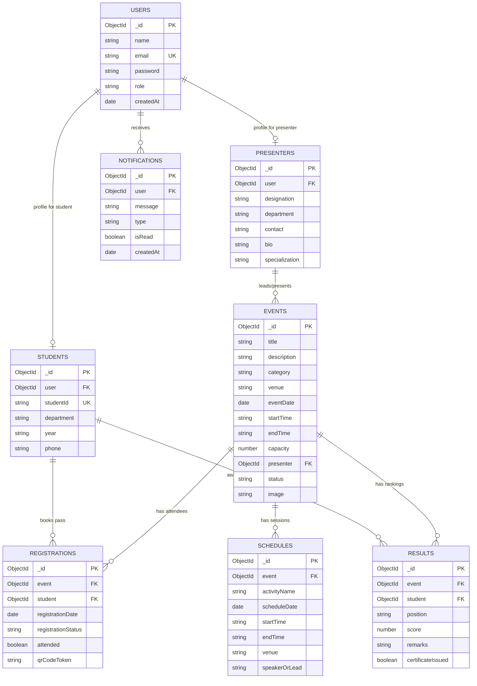

# Software Requirements Specification (SRS)
## College Event Presenter Management System

---

## 1. Introduction

### 1.1 Purpose
The purpose of this document is to provide a detailed Software Requirements Specification (SRS) for the **College Event Presenter Management System**. This web-based platform automates collegiate event planning, speaker/coordinator assignments, student seat allocations, schedule timelines, competitive evaluations, and verified certificate generation.

### 1.2 Scope
The system centralizes event management for universities and educational institutions. It eliminates paper-based forms, prevents duplicate student registrations, enforces room capacity limits, and provides distinct role-based experiences for:
- **Campus Administrators**
- **Event Coordinators / Presenters**
- **Student Participants**

---

## 2. System Architecture

```mermaid
flowchart TD
    subgraph Client ["Client Layer (Frontend)"]
        UI["Modern Responsive UI\n(HTML5 / CSS3 / Vanilla JS)"]
        Router["SPA Hash Router (#/events, #/dashboard)"]
        ApiClient["REST API Client\n(JWT Bearer Interceptor)"]
    end

    subgraph Server ["Server Layer (Node.js & Express)"]
        AuthMid["JWT Auth Middleware & RBAC"]
        Validators["Input Validation Layer"]
        Controllers["Controllers\n(Auth, Events, Presenters, Reg, Schedules, Results, Reports)"]
    end

    subgraph Database ["Data Layer (MongoDB & Mongoose)"]
        UserCol[("users")]
        StudentCol[("students")]
        PresenterCol[("presenters")]
        EventCol[("events")]
        RegCol[("registrations\n(Unique Compound Index)")]
        SchCol[("schedules")]
        ResCol[("results")]
        NotifCol[("notifications")]
    end

    UI --> Router
    Router --> ApiClient
    ApiClient -->|HTTP/REST + JWT| AuthMid
    AuthMid --> Validators
    Validators --> Controllers
    Controllers --> Mongoose ODM
    Mongoose ODM --> UserCol & StudentCol & PresenterCol & EventCol & RegCol & SchCol & ResCol & NotifCol
```

---

## 3. Database Schema Design (Entity-Relationship)



---

## 4. Functional Requirements

### 4.1 Authentication & Authorization
- **FR-01 (User Registration):** Students and presenters can self-register or be provisioned by administrators. Passwords must be hashed using `bcrypt` (10 salt rounds).
- **FR-02 (JWT Authentication):** On successful login, the server issues a signed JWT token containing user identity and role with a 7-day expiration.
- **FR-03 (Role-Based Access Control):** Middleware verifies role authorization:
  - `admin`: Full administrative access to events, presenters, users, registrations, reports.
  - `presenter`: View assigned events, manage session schedules, view student rosters, publish competitive rankings.
  - `student`: Register for events, view ticket codes, manage registrations, track schedules, view personal certificates.

### 4.2 Event Management
- **FR-04 (Event Lifecycle):** Administrators and presenters can create, edit, update status (`upcoming`, `ongoing`, `completed`, `cancelled`), and delete events.
- **FR-05 (Search & Filter):** Public and registered users can filter events by Category (Technical, Workshop, Seminar, Hackathon, Cultural, Sports), Status, Date, and search query.

### 4.3 Student Registration & Capacity Checks
- **FR-06 (Capacity Enforcement):** The backend validates available seats before accepting registrations. If `registeredCount >= capacity`, the request is rejected with HTTP 400.
- **FR-07 (Duplicate Prevention):** A unique compound index `{ event: 1, student: 1 }` prevents a student from registering twice for the same event.
- **FR-08 (Digital Ticket Passes):** Upon registration, a unique ticket pass token (e.g. `REG-AI-9021`) is generated for student check-in.
- **FR-09 (Cancellation):** Students can cancel their own registrations, freeing up the seat for other students.

### 4.4 Event Schedules & Agendas
- **FR-10 (Timeline Management):** Event coordinators can define chronological sessions with start time, end time, venue, and lead speaker.

### 4.5 Results, Rankings & Certificates
- **FR-11 (Leaderboards & Scoring):** Coordinators can publish ranked results (1st, 2nd, 3rd, Special Mention), scores (0-100), and judge remarks.
- **FR-12 (Certificate Verification):** Students can view verified participation and award certificates on their dashboard.

### 4.6 Notifications & Reports
- **FR-13 (Real-Time Notifications):** System generates alerts for event announcements, schedule updates, registration confirmations, and published results.
- **FR-14 (Analytics & Reporting):** Summary reports calculate event capacity utilization percentages, department distributions, and attendee conversion rates.
- **FR-15 (CSV Export & Print):** Reports can be downloaded as `.csv` files or printed directly using dedicated CSS print stylesheets.

---

## 5. Non-Functional Requirements

| Category | Requirement Specification |
|---|---|
| **Performance** | API responses delivered in < 150ms under standard loads. |
| **Security** | Passwords hashed with bcrypt; JWT signed with secret; No passwords exposed in responses. |
| **Database Integrity**| Compound indexes and foreign key references prevent orphaned records and duplicates. |
| **Reliability** | Automatic graceful fallback between local MongoDB, Atlas, and in-memory server. |
| **Usability** | 100% responsive design tested on desktop, tablet, and mobile browsers. |

---

## 6. Verification & Test Plan

| Test ID | Module | Test Scenario | Expected Outcome | Status |
|---|---|---|---|---|
| **TC-01** | Auth | Register with valid credentials | User created, password hashed, token returned | **PASSED** |
| **TC-02** | Auth | Register with existing email | HTTP 400 Duplicate email error returned | **PASSED** |
| **TC-03** | RBAC | Student attempts to create event | HTTP 403 Forbidden error returned | **PASSED** |
| **TC-04** | Events | Create event with 2 seats capacity | Event created with `capacity: 2` | **PASSED** |
| **TC-05** | Reg | Student 1 registers for event | Pass ID generated, count = 1/2 | **PASSED** |
| **TC-06** | Reg | Student 1 tries registering again | Duplicate prevention blocked with 400 | **PASSED** |
| **TC-07** | Reg | Student 3 registers when full | Registration blocked (Capacity full) | **PASSED** |
| **TC-08** | Schedule| Add session to event timeline | Schedule saved, registered students notified | **PASSED** |
| **TC-09** | Results | Publish 1st place award | Ranking saved, winner certificate issued | **PASSED** |
| **TC-10** | Reports | Export CSV of all events | File returned with `text/csv` header | **PASSED** |
